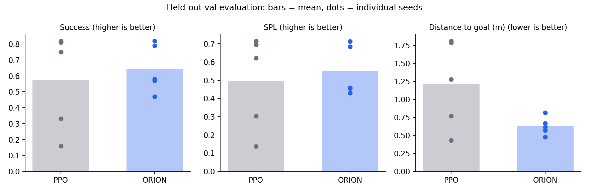
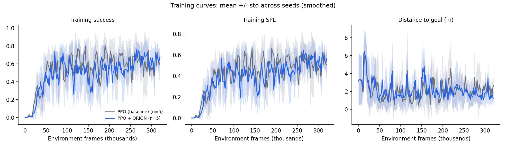

# ORION: Success-Aware PPO for Embodied Navigation

ORION adds an **episode-success value head** to PPO for PointGoal navigation in
[Habitat-Lab](https://github.com/facebookresearch/habitat-lab) (v0.3.3). The head
reads the policy's recurrent features and predicts *"will this episode
eventually succeed?"*, and its loss shapes the shared representation.

**Main result (10 seeds, held-out episodes):** ORION reduced final distance to
goal by **39%** (0.64 m vs 1.06 m, Welch p = 0.021), but did **not** change
success rate or SPL. Agents get closer to the goal but do not stop more
reliably, which points to the STOP decision as the bottleneck.

---

## Method

Habitat reports `success = 1` only on the final step of a successful episode.
Using that flag directly as a per-step label teaches "is this the last step of
a success", not "will this episode succeed". ORION instead treats the flag as a
sparse terminal reward and learns a second value function over it.

For each rollout step `t` (gamma = 1), the target is a TD(lambda) success return:

    if transition t ends the episode:  G_t = success_t
    otherwise:                          G_t = (1 - lambda) * p_{t+1} + lambda * G_{t+1}

`p_{t+1}` is the head's own detached prediction, so episodes that span rollout
boundaries are handled by bootstrapping, exactly like a PPO critic. The loss is
`loss_scale * BCE(logits, G)`, with `loss_scale = 0.05` and `lambda = 0.95`.

| Component | File |
|---|---|
| Success head + TD(lambda) targets | `habitat-baselines/habitat_baselines/rl/ppo/orion_aux_loss.py` |
| Success flags in rollout storage | `habitat-baselines/habitat_baselines/common/rollout_storage.py` |
| Flag collection from Habitat `info` | `habitat-baselines/habitat_baselines/rl/ppo/ppo_trainer.py` |
| Passing targets to auxiliary losses | `habitat-baselines/habitat_baselines/rl/ppo/ppo.py`, `policy.py` |
| Matched configs | `habitat-baselines/habitat_baselines/config/pointnav/orion_ppo_baseline.yaml`, `orion_success.yaml` |

The two configs are identical except for the auxiliary loss and output folders.

---

## Results

Setup: PointNav on `habitat-test-scenes`, 1 environment, 10,000 PPO updates
(~320k frames) per run, CPU-only (MacBook Air). Each run's final checkpoint
(`ckpt.9`) was evaluated on the 100 held-out `val` episodes.

| Method | Success (higher better) | SPL (higher better) | Distance to goal, m (lower better) |
|---|---|---|---|
| PPO (baseline) | 0.619 +/- 0.240 | 0.519 +/- 0.198 | 1.056 +/- 0.457 |
| PPO + ORION | 0.635 +/- 0.171 | 0.526 +/- 0.150 | **0.643 +/- 0.163** |

Mean +/- std across 10 seeds per method.

| Metric (ORION vs PPO) | Difference | Welch p | Mann-Whitney p |
|---|---|---|---|
| Success | +0.016 | 0.87 | 0.73 |
| SPL | +0.007 | 0.93 | 0.91 |
| Distance to goal | -0.413 m | **0.021** | **0.021** |

A bootstrap 95% confidence interval for the distance difference is
-0.71 m to -0.14 m. Per-run values are in [`results/summary.md`](results/summary.md)
and [`results/eval_results.csv`](results/eval_results.csv).

**Observations:**
- PPO ended more than 1 m from the goal on 5 of 10 seeds; ORION on 1 of 10.
- PPO had 3 weak seeds (success below 0.4); ORION had none. With 10 seeds this
  difference is not statistically significant (it is an observation, not a claim).
- The learning curves show no faster learning: both methods plateau after
  about 50k frames.

**Interpretation.** Success requires calling STOP within 0.2 m of the goal.
ORION's agents end closer, yet do not succeed more often, which suggests they
approach well but stop at the wrong moment. A natural next step is to use the
success head's prediction to gate the STOP action.

### How the conclusion changed with more seeds

| Seeds | Success difference (p) | Distance difference (p) |
|---|---|---|
| 3 | +0.20 (0.39) | -1.06 m (0.019) |
| 5 | +0.07 (0.66) | -0.59 m (0.10) |
| 10 | +0.02 (0.87) | -0.41 m (0.021) |

With 3 seeds ORION looked clearly better, mostly because two of PPO's three
seeds happened to be weak. More seeds removed the apparent success gain and
left a smaller but consistent distance improvement. This is why the final
claims rest on 10 seeds.

---

## Bugs found and fixed

1. **Critic never trained (variable shadowing).** In `NetPolicy.evaluate_actions`,
   a loop that passed auxiliary targets reused the name `value`, overwriting the
   critic's output. PPO's value loss was computed against a tensor with no
   gradient, so the critic never learned. This affected every earlier run,
   baseline included, so all previous results were discarded and retrained.
2. **Wrong auxiliary target.** The first version used the per-step success flag as
   the label. It was replaced by the bootstrapped success return above.
3. **Checkpoint loading on PyTorch 2.6+.** `torch.load` now defaults to
   `weights_only=True`, which rejects Habitat checkpoints (they store an
   OmegaConf config). Loading local, trusted checkpoints now passes
   `weights_only=False`.

---

## Limitations

- **Small dataset:** `habitat-test-scenes` has 3 scenes, so val episodes are
  unseen but the houses are not. Results may not transfer to Gibson or HM3D.
- **Small compute budget:** 320k frames per run on CPU with 1 environment, far
  below standard PointNav training (tens of millions of frames or more).
- **Final checkpoint:** `ckpt.9` is written at roughly 93% of training. All 20
  runs were treated identically.
- **Multiple comparisons:** three metrics were tested; under a strict Bonferroni
  correction (alpha = 0.017) the distance result (p = 0.021) is borderline.
- **Head diagnostics:** the head's average prediction tracks the training
  success rate, but per-episode calibration (does it predict *which* episodes
  succeed?) has not been measured yet.

## Future work

- Confidence-gated STOP using the success head.
- Per-episode calibration and failure breakdown (stop errors vs. never reaching the goal).
- Ablations over `loss_scale` and `lambda`.
- Larger scene datasets and longer training on GPU.

Related work: auxiliary tasks for PointGoal navigation (Ye et al., 2020) and
progress estimation for navigation agents (Ma et al., 2019).

---

## Reproduce

Requires a working Habitat-Lab v0.3.3 install with the `habitat-test-scenes`
PointNav data.

    # Train PPO and ORION for each seed (edit the seed list in the script)
    ./run_orion_batch.sh

    # Evaluate ckpt.9 of every run on the val split
    ./run_orion_eval.sh

    # Build results/summary.md, eval_results.csv and all plots
    python analyze_orion.py

    # Optional: live progress dashboard
    ./watch_orion.sh

A single run:

    python -u -m habitat_baselines.run --config-name=pointnav/orion_success.yaml \
      habitat.seed=1 \
      habitat_baselines.checkpoint_folder=data/runs/orion_s1 \
      habitat_baselines.tensorboard_dir=tb/runs/orion_s1

Note: on macOS, Habitat could not run two simulators at once, so runs execute
sequentially (about 75 minutes each on an Apple-silicon MacBook Air).

---

This repository is a fork of Habitat-Lab (MIT License). The original
Habitat-Lab README is kept in [`README_habitat_lab.md`](README_habitat_lab.md).
